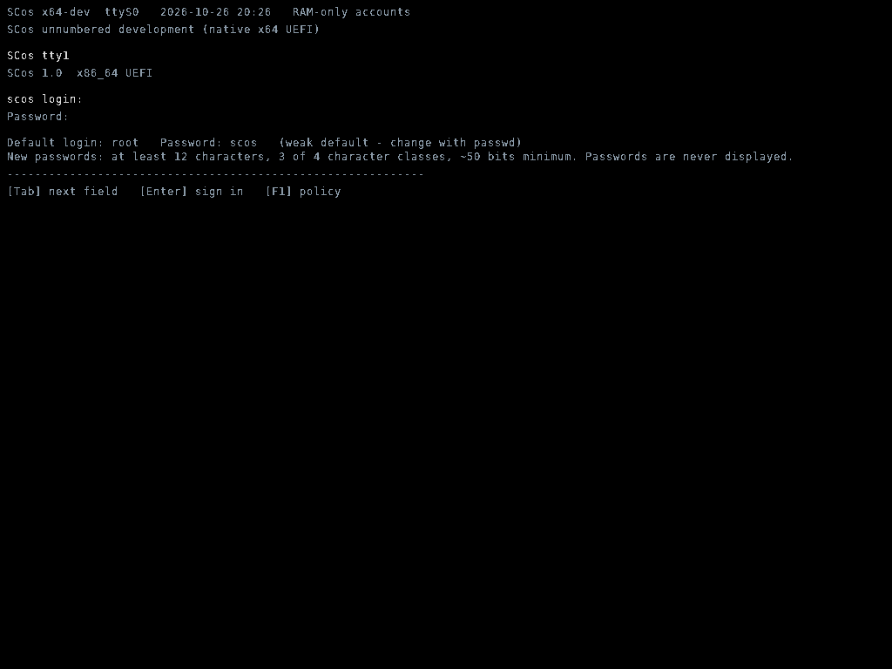

# SCos security — the owner is in control

SCos is still SCos: the same desktop, apps, windows, themes, filesystem
commands, Lua CAT packages, drivers and native x64 UEFI build targets. Nothing
here is a Linux port, and the frozen 32-bit milestone image is untouched.

**Design rule:** the person who owns the machine decides. Security protects the
owner, it does not protect the machine *from* the owner. Every protection that
could get in the way is a user choice, on by default where it has a clear
benefit, and off the moment you turn it off. No app is forced into isolation,
but an app the owner *does* isolate is a real process with its own page tables,
private memory and a kernel-enforced capability set (§5) - not a flag that a
package can ignore. No Secure Boot, no signed boot, no firmware enrolment: boot
verification is the same as a stock Linux PC without Secure Boot - none
cryptographically, just a CRC32 that catches a damaged kernel file.

A fresh machine signs in like Linux does, with one account at the **highest
permission level**:

```
login: root
Password: scos
```

Every account has top permission by default - that is what "all accounts have
the same permissions" means here. The shipped `root` is an ordinary account
record with the `administrator` role, not a built-in uid-0 superuser; it can be
renamed or deleted. Lower-power `user` and `guest` accounts can still be created
explicitly (`useradd <name> user|guest`), and `choices set roles.enabled on`
makes those role differences actually restrict anything. Change the default
password with `passwd` as soon as you can (see §6).

Read §2 before treating any of this as a boundary against a determined attacker.

---

## 1. What is in the tree

| File | Role |
| --- | --- |
| `kernel/include/security.h` | Public API, limits, record types, choice API, vault/AEAD declarations. Freestanding; used by host tests. |
| `kernel/desktop/sec_core.c` | SHA-256, HMAC-SHA256, PBKDF2-HMAC-SHA256, constant-time compare, password/username policy, record codec, checksums. |
| `kernel/desktop/sec_aes.c` | AES-256, CTR, encrypt-then-MAC AEAD, volume-key wrap/unwrap. |
| `kernel/desktop/sec_choices.c` | **User security choices** and per-app isolation choices, persisted and authenticated. |
| `kernel/include/process.h`, `kernel/desktop/process.c` | **Process isolation engine**: process table, per-app PML4 domains, private arenas, kernel-held capability sets, VFS namespaces. |
| `kernel/src/memory.c` | Page-table domain manager: separate CR3 per app, huge-leaf splitting, identity-map removal for private pages. |
| `kernel/desktop/sec_vault.c` | Encrypted disk header, key slots, volume-key lifetime, seal/open. |
| `kernel/desktop/security.c` | Accounts, sessions, lockout, audit, roles, shell commands, entropy pool. |
| `kernel/desktop/login.c` | **Plain TTY-style secure console** (login, setup, lock, recovery) and the lock-screen app API. |
| `kernel/drivers/ata.c` | Encrypted `SCOSVAUL` image or, by choice, plain `SCOSFS2`. |
| `kernel/desktop/wm.c`, `lua_apps.c` | First-launch per-app isolation prompt, `w->isolated`, and the `APP_T0`/`APP_T1` process entry/exit wrappers around every app callback. |
| `tools/tests/` | Host KATs, booted-guest encryption/choice/isolation tests. |

Removed in this revision (owner's request): `boot/uefi/rsa_verify.c`,
`boot/uefi/trust_anchor.h`, `tools/scos_*`, `keys/`, `BOOT.SIG`, the whole
RSA manifest verifier in the UEFI stub, and all Secure Boot enrolment
instructions. Boot integrity is the plain `KERNEL.CRC` accidental-corruption
check only. **Nothing verifies the boot files cryptographically, by design.**

---

## 2. Threat model — what this actually defends

**It defends:**

* Someone walking up to a booting or running SCos machine and using the desktop,
  Terminal, TTY console or filesystem without an account — **unless the owner
  turns `login.required` off**.
* Online password guessing (rate limiting, exponential lockout, generic error
  text) — unless `lockout` is off.
* Offline cracking of credential metadata (random 128-bit salts, calibrated
  PBKDF2, strong password policy) — unless `password.policy` is off.
* **Offline reading of a removed/copied disk** when `vault.encryption` is on
  (the default). The saved tree is AES-256-CTR ciphertext; the volume key is
  wrapped under a password-derived KEK and never stored in cleartext.
* **Offline modification of vault metadata.** The entire cleartext vault header
  (account DB, audit log, choice file, key slots, generation, IV) is the AEAD's
  **associated data**. A changed byte anywhere in it invalidates the tag at the
  next unlock.
* Credential leakage through UI, echo, scrollback, history, klog or audit. Only
  `*` markers are painted; secret buffers are scrubbed.
* An unattended session (auto-lock) and a forgotten password (a one-time
  recovery code issued by `recovery`; it also unwraps the volume key, so
  recovery does not destroy saved data).
* A stopped desktop: the rescue TTY requires re-authentication.
* Privilege escalation through a newly added command: guest authorization is an
  allow-list (unless `guest.restrict` is off).
* **One isolated app reading another app's private memory or files.** Each
  isolated window gets its own PML4 and private physical pages that are removed
  from the shared identity map. Accessing another process's arena raises #PF,
  not a policy error. The VFS namespace, theme, notification and app-registration
  capabilities are checked at the kernel boundary for native C apps and Lua CAT
  packages alike (§5).
* **One account reading another account's private files.** `home/users/<name>/`
  is enforced on every lookup/read/write; kernel metadata I/O is exempt.
* **Replay of an older saved image.** The AEAD header's generation is compared
  with an on-disk anchor that lives outside the restorable image (§6).

**It does NOT defend:**

* **No cryptographic boot verification, exactly like Linux without Secure
  Boot.** The loader checks `KERNEL.CRC` with CRC32, which detects a truncated
  or corrupted kernel file, not a malicious one. There is no signed manifest,
  no measured boot, no keys. Anyone who can write the ESP can replace
  `BOOTX64.EFI`, `KERNEL.ELF` or any `.MOD`. The owner asked for this; do not
  describe the image as "secure boot" or "verified boot".
* **Isolation is NOT a ring-3 user-mode boundary.** All app code still runs at
  CPL0 in a cooperative kernel. A deliberately malicious *native C* app can
  execute privileged instructions (`mov cr3`, MSR writes) or reach kernel
  globals that are mapped in every domain; it is contained against reading
  another process's private arena and against the mediated VFS/theme/IPC APIs,
  not against arbitrary CPL0 machine instructions. Loaded GPU modules are part
  of the kernel and are never isolated. Real CPL3 execution with a syscall gate
  is the remaining step for a hard boundary. CAT packages are contained by the
  Lua VM *plus* their private page-table domain, but a VM escape is still CPL0.
* **Per-user file isolation is access control, not separate encryption.** One
  volume key encrypts the whole tree, so someone who can unwrap the vault
  offline and parse the FS2 image can read every account's files. Inside the
  running OS, `home/users/<name>/` is enforced at the VFS boundary.
* **Rollback detection is disk-local, not a TPM.** `fs_image_save()` also
  writes a generation anchor to LBA 64, a GPT-reserved sector outside the
  256-sector vault image, after the image is committed and read back. Boot
  refuses an older (but still AEAD-valid) image, so copying back an old image
  file is detected. Cloning the **whole disk** - anchor included - still wins,
  and plaintext (`vault.encryption=off`) images have no generation at all.
  Only a TPM or an off-device monotonic counter closes that case.
* **The shipped default password.** `root` / `scos` is deliberately weak and is
  shown on the login console while it is active. It is a convenience for a
  first boot, not a secret; `passwd` clears the hint and re-wraps the vault
  key. `login.hint` can hide the hint.
* **Everyone is an administrator by default.** With `roles.enabled` off,
  `security_is_admin()` returns true for every signed-in account and the role
  checks are skipped - that is deliberate, not a lower common denominator. The
  base `root` account also carries the `administrator` role so it stays top
  power when roles are enforced. There is no separate uid-0 superuser to
  escalate to; all code is ring 0 anyway.
* **Physical access wins.** A hardware debugger, JTAG/ICE, or the QEMU GDB stub
  used by tests can call any kernel function. The test harness calls the
  *production* setup/authentication entry points; there is no `#ifdef`
  backdoor.
* **RAM-only machines.** Without a verified ATA SCos-data partition, accounts,
  choices and files are session-only and the `root`/`scos` account is recreated
  at each boot.
* **Legacy plaintext images.** A `SCOSFS2` image is loaded once and re-saved
  encrypted at first sign-in (when `vault.encryption` is on). With it off,
  plaintext is written deliberately.
* **Legacy multi-user migration.** Only the account that signs in gets a key
  slot immediately; others need their password set again by an administrator.

---

## 3. User security choices (the centre of the design)

Every restriction is a named switch in `system/security/choices.cfg`. The file
is checksummed and its bytes are copied into the vault header, which is AEAD
associated data — so choices survive reboot and an offline edit is detected at
unlock. On RAM-only machines they are session-only, like accounts.

**Defaults keep important things ON.** All of these can be turned off:

| Key | Default | What it controls |
| --- | --- | --- |
| `login.required` | on | Password prompt before the desktop. Off = implicit session as the lowest-uid enabled account (first-run setup still runs). |
| `lock.enabled` | on | `lock`, F-key lock and the lock console. |
| `lock.idle` | on | Auto-lock after `policy idle` minutes (10 by default). |
| `password.policy` | on | Strong password rules. Off = minimum 4 characters only. |
| `password.history` | on | Reject recently used passwords. |
| `password.age` | on | Force a change after `policy maxage` days (90 by default). |
| `lockout` | on | Exponential delay after failed sign-ins. |
| `guest.restrict` | on | Guest command allow-list. |
| `audit.enabled` | on | Record the security audit ring. |
| `vault.encryption` | on | Encrypt the saved filesystem image. Off = plain `SCOSFS2`. |
| `recovery.enabled` | on | Allow one-time recovery codes (F8). |
| `isolation.prompt` | on | Ask how to launch an app the first time. |
| `isolation.default` | **off** | Isolate apps by default when no per-app choice exists. Off by design: nothing is forced. |
| `confirm.destructive` | on | Ask before destructive shell commands. |
| `roles.enabled` | **off** | Enforce admin/user/guest privileges. Off = **every account has top (administrator) permission**, whatever role its record stores. On = `user`/`guest` become lower-power as requested. |
| `login.hint` | on | Show the `root` / `scos` hint on the console while default credentials are active. |

Shell interface (Terminal and TTY, help text updated in both):

```
choices                       list every switch, default and per-app choice
choices set <key> on|off      change one (admin)
choices app <id> always|never|ask   change a per-app isolation choice (admin)
choices default               restore all defaults (admin)
```

With `roles.enabled` off (the default) every account is an administrator and can
change `choices`. Turn roles on and a guest is limited to reading them. Changing
`vault.encryption` from off to on while no volume key is held requires signing
out and back in (that is when the password-derived key is created); the shell
prints that hint. Turning it off writes a plain image immediately and keeps the
protected metadata inside the tree so it still survives a reboot.

Two choices conflict on purpose, and the kernel tells you so: with
`login.required=off` **and** `vault.encryption=on`, an encrypted vault still
needs a password to unwrap the volume key, so the sign-in console still appears
at boot. Turn `vault.encryption` off too if you want a genuinely passwordless
boot.

**App-facing API** (no Settings app is shipped — build your own):

```c
int  security_choice(const char *key);
int  security_choice_set(const char *key, int value);
int  security_choice_count(void);
void security_choice_describe(int i, char *out, size_t cap);
int  security_choices_load(void);
int  security_choices_save(void);
void security_choices_default(void);
const char *security_choice_error(void);
```

`security_choice_set()` persists immediately (VFS copy + vault header) and
marks the disk dirty so the normal `save` path flushes it. A Settings app can
therefore be a thin UI over these calls; nothing else needs to change in the
kernel. Add a new `struct choice_def` row in `sec_choices.c` and wire the
enforcement point — unknown keys in an existing file keep their defaults, so
adding choices never invalidates saved files.

---

## 4. Login and lock: a plain TTY console

There is **no graphical login screen and no graphical lock screen**. At boot —
and whenever the session is locked — the framebuffer is cleared to black and a
plain monospace text console is drawn, like a Linux machine before a desktop
starts:

```
SCos x64-dev  ttyS0  2026-10-26 18:58  RAM-only accounts
SCos unnumbered development (native x64 UEFI)

SCos tty1
SCos 1.0  x86_64 UEFI

scos login: root
Password: ****
Default login: root   Password: scos   (weak default - change with passwd)
New passwords: at least 12 characters, 3 of 4 character classes, ~50 bits minimum.
[Tab] next field   [Enter] sign in   [F1] policy
```



The same renderer handles first-run setup, sign-in, screen lock, password
change, re-authentication and recovery. Masked fields paint only `*`; input
buffers are scrubbed; input uses the same `kbd_poll`/`usb_poll` path as the WM;
`cpu_hlt()` keeps the machine idle while waiting.

### Build your own lock-screen app (documented API)

No lock-screen app is included. If you want one, register a renderer:

```c
typedef int (*security_lock_screen_fn)(const char *user);
void security_set_lock_screen(security_lock_screen_fn fn);
```

Contract:

* The callback owns the framebuffer while the session is locked. Draw masked
  input yourself; never paint a typed password.
* Verify with `security_api_verify(idx, pw, msg, cap)` and then call
  `security_api_unlock_session()`. `security_api_session()`,
  `security_api_locked()`, `security_api_deny_remaining()` and
  `security_api_min_policy()` are available for the UI.
* Return `1` when unlocked, `-3` to switch user (the kernel logs out and shows
  the console), `0` to keep waiting.
* Registering `NULL` restores the default console. If `lock.enabled` is off the
  kernel never calls the callback.

A Settings/choices app can use the same pattern: read `security_choice*`, draw
your own UI, call `security_choice_set()`.

---

## 5. Process isolation: a per-app user choice, never forced

On the **first user-driven launch** of an app (desktop icon, Launcher, taskbar
pin, pin menu), the WM shows a four-item prompt:

1. **Always launch isolated** — stored for this app.
2. **Never launch isolated** — stored for this app.
3. **Isolated once (ask next time)** — no stored choice, this launch is isolated.
4. **Unisolated once (ask next time)** — no stored choice, this launch is normal.

`choices app <id> always|never|ask` changes it later. `isolation.prompt` off
suppresses the prompt entirely; `isolation.default` (off) decides the flag for
apps with no choice when the prompt is suppressed. **Programmatic**
`wm_open_app()` calls (scripts, app-to-app hand-offs, the test harness) never
prompt, so existing behaviour is unchanged.

The decision is stored in `choices.cfg` (`A|app-id|mode|last` lines), so it is
AEAD-authenticated with the rest of the vault header and survives reboot. The
choice seeds `struct window.isolated`, which `proc_create()` turns into a
process (§5).

### What "isolated" actually does

The flag no longer just sits on the window. `proc_create()` registers a
**process** with its own hardware memory domain, and the WM switches into it
around **every** app callback (`APP_T0` / `APP_T1` in `wm.c`):

1. **Separate page tables.** `memory_domain_create()` builds a private PML4
   that shares all kernel mappings but has one private PML4 slot for the app's
   own 4 MiB arena. `memory_domain_switch()` writes CR3 on entry and restores
   the kernel root on exit. A process cannot resolve another process's arena:
   the PD entry is simply **not present**.
2. **No identity-map alias.** Each private frame is removed from the shared
   identity map by splitting the covering 1 GiB / 2 MiB huge leaves down to
   4 KiB leaves and clearing that one PTE. A ring-0 app cannot cheat by poking
   the physical address. `CR0.WP` is already set, so kernel text/rodata stay
   read-only. Frames and table pages are restored and released on close.
3. **Private heaps.** Every isolated process starts with 64 KiB of private
   scratch. A Lua CAT package's whole 2 MiB VM arena is allocated there too, so
   its state, strings and bytecode live only in its own PML4.
4. **Kernel-held capabilities.** `PROC_CAP_*` is stored in kernel memory, never
   passed by app code. The VFS (`vfs_access`, `vfs_lookup`, `vfs_read`,
   `vfs_write`, `vfs_mkdir`, `vfs_delete`, `vfs_rename`), `theme_set_index`,
   `wm_notify` and the CAT API read `proc_current()` — set only by the WM. An
   isolated app has `VFS_READ|VFS_WRITE|SYSINFO` but **no** `THEME`, `IPC` or
   `APPCTL`, so global theme edits, notifications, dialogs, icon changes and
   `scos.theme_apply`/`theme_custom` fail.
5. **Private VFS namespace.** An isolated app can read/write only
   `home/appdata/<its-id>/**` and its own `.cat` package under `home/apps/` or
   `home/demos/`. Documents, downloads, `system/` and every other app's data
   are absent at lookup and denied at read/write. This applies to native C apps
   too — the check is in `vfs.c`, not in an app-facing helper.

Native C apps are still compiled-in ring-0 code and are trusted not to execute
`mov cr3` themselves; all app code shares kernel globals. GPU modules are part
of the kernel and are never isolated. See the honest boundary in §2. An app the
owner chose **never** to isolate gets `PROC_CAP_ALL`, no domain and the original
unrestricted behaviour — nothing is forced.

Owner-facing commands: `isolation` lists pid, app, owner, isolated state,
domain and capability mask; `security` reports the number of isolated domains.

APIs: `security_app_isolation*()` / `security_app_launch_isolated()` for the
choice; `proc_create()`, `proc_enter()`, `proc_leave()`, `proc_destroy()`,
`proc_private_alloc()`, `proc_cap_allowed()`, `proc_path_allowed()`,
`proc_pid_probe()`, `proc_pid_access()`, `proc_domain()`, `proc_arena_va()` in
`process.h` for the engine itself.

### Per-account private files

`security_init()` creates `home/users/<name>/` for every account. `vfs.c`
refuses lookup/read/write/rename/delete on that subtree unless the name matches
`security_current_user()` (or the call is kernel metadata I/O before sign-in).
This is real access control at the VFS boundary, independent of app isolation.
It is not separate encryption — see §2.

---

## 6. Accounts, database and encrypted vault

### Default account and top-level permissions

On a machine with no account database, `security_init()` creates exactly one
account: name `root`, password `scos`, **`SC_ROLE_ADMIN` (the highest role)**,
uid 1000, no `SC_FLAG_MUSTCHANGE`. It is written through the normal checksummed
database path and the vault volume key is wrapped to that password, so the
encrypted filesystem works from the first sign-in. No recovery code is generated
at boot (there is no setup screen to display it); the `recovery` command in
Terminal/TTY generates one, shows it once, and binds a vault key slot. The
first-run setup console is still present as a fallback if
the database is rejected, but a fresh boot no longer stops to ask you to invent
a password.

**All accounts have top permission.** `security_is_admin()`,
`security_command_allowed()`, `security_write_denied()` and the account-shell
guards consult `roles.enabled`; with it off (the default) every signed-in
account - admin, user or guest - is treated as an administrator. `security` and
`id` print `administrator (all accounts equal)`, and `users` says so explicitly.
`useradd <name>` also defaults to `admin`; lower-power accounts are opt-in via
`useradd <name> user|guest` (or `usermod --role`). `choices set roles.enabled on`
is what makes those lower roles restrict anything - the role records are kept
either way, so turning the switch on does not silently change account data.
The "last administrator" guards only apply while roles are enforced.

`root` is an ordinary account record, not a built-in uid-0 superuser: there is
no separate privileged account type, and the name can be changed or removed.
`passwd` clears `security_api_default_credentials()` (which removes the login
hint), rebinds the vault key slot and adds the old password to history. Deleting
`root` also clears the hint. If the database is ever left with no administrator,
`security_is_admin()` falls back to equal top permission rather than locking
the owner out or rejecting the database. On a RAM-only machine the default
account is recreated at every boot, just like the old first-run setup.

The account database is unchanged from the first security phase: strict parsing,
`SCos-accounts-v1` magic, `P|` policy, `R|` recovery, `U|` accounts, `C|`
SHA-256 checksum, last-known-good backup. `vfs.c` refuses reads/writes/rename/
delete on the normalized `system/security` subtree; `security_fs_restore()`
re-materializes it after a factory reset or vault unlock.

The encrypted image layout (`SCOSVAUL`, 128 KiB):

```
0        8   "SCOSVAUL"  (8..11 = version)
12       4   account DB length       16  slot count (18)
20       4   generation              24  random vault id (16)
40       4   fresh AEAD IV (16)      56  payload length (98 304)
60       4   flags                   64  audit length
68       4   choices length
96    2 880  18 × 160-byte key slots
2976 14 368  account database (cleartext, checksummed)
17344 7 792  audit log (cleartext)
25136 4 096  choices.cfg (cleartext, checksummed)
32736    32  HMAC-SHA256 tag
32768 98 304  AES-256-CTR ciphertext of an SCOSFS2 tree
```

**Anti-rollback anchor.** `vault_seal()` increments a generation in the AEAD
header (so it is authenticated). After `fs_image_save()` commits the 256-sector
image and verifies the readback, `rollback_bump()` writes that generation to
LBA 64 - a GPT-reserved sector **outside** the image - with a CRC. At boot,
`fs_image_load()` calls `rollback_check(vault_generation())` after
`vault_stage()`; a lower generation is refused with
"saved image rolled back" and the encrypted tree is withheld. Restoring just
the image file cannot restore the anchor. Cloning the entire disk can, which is
why this is detection, not TPM-grade protection. `rollback_valid()`,
`rollback_high_water()`, `rollback_check()` and `rollback_bump()` are exported.

Everything before byte 32 736 is AEAD associated data. Each key slot holds a
username, a fresh KDF salt, iteration count, a PBKDF2 verifier and the VEK
wrapped under the second PBKDF2 output block. Signing in unwraps the VEK;
logout burns it; `save` fails closed when the key is not held. A recovery slot
allows a forgotten password to recover the data too. Password changes re-wrap
before the account record is committed.

**Default policy** (administrator-tunable via `policy set`): 12 characters,
3 of 4 classes, 50-bit entropy floor, 5 failures, 30–900 s lockout, 10-minute
idle lock, 90-day password age, 5 remembered passwords, calibrated PBKDF2
(typically 20 000–1 000 000 iterations, ~250 ms target). Existing databases
keep their recorded values.

Commands (Terminal and TTY): `whoami`, `id`, `security`, `passwd`, `users`,
`useradd`, `userdel`, `usermod`, `policy`, `audit`, `lock`, `logout`, `su`,
`reauth`, `recovery`, `choices`, `isolation`. `isolation` lists each running
process with its pid, app id, account, isolated flag, page-table domain and
capability mask. `useradd <name>` defaults to the top (administrator) role; pass
`user`, `guest` or `admin` as the second argument to choose explicitly.
Passwords are never command arguments.

---

## 7. Verification performed

* `make -j4` — clean `-Wall -Wextra -Werror` native x64 UEFI build.
* `python3 tools/check_milestone.py` — frozen r43 32-bit image unchanged.
* `tools/tests/test_security.py` — 86 host KATs (SHA-256, HMAC, PBKDF2 one/two
  blocks, AES-256 FIPS 197, CTR SP 800-38A, AEAD, VEK wrap, policy, codec,
  checksum, zero-history reboot), source-level wiring checks for the TTY
  console/choices/isolation prompt and the absence of boot signing, a booted
  guest (authentication, protection, password change/history, guest allow-list),
  an ATA reboot that reloads the vault, a guest proof that the saved image holds
  no plaintext and that header/tag/ciphertext edits are rejected, and a guest
  proof that choices default on, actually change behaviour, survive a reboot,
  that `vault.encryption=off` writes a plain image, and that the WM shows the
  first-launch isolation prompt and stores the answer.
* `tools/tests/test_isolation.py` — source-level wiring checks for the process
  engine plus a booted guest that opens two isolated native apps and an isolated
  CAT package, then proves: each has a distinct PML4; a `proc_pid_probe()` CR3
  switch reads its own marker but **returns 0** for the other process's arena
  (not present in that page table); the real `vfs_access()` path denies
  documents, `system/` and another app's appdata while allowing its own;
  theme/IPC/appctl capabilities are withheld; per-account `home/users/` files
  are private; an unisolated app keeps full access; and closing the windows
  releases the private frames. No panic, no leaked processes. A second booted
  guest saves twice, replays the older authenticated image into the data
  partition, and verifies that the next boot refuses it using the LBA 64 anchor.
* A real QEMU framebuffer screenshot of the tty login console
  (`docs/migration/login-console.png`) was captured and inspected: black
  background, monospace `scos login:` prompt, masked password, the default
  credential hint, no panels or desktop content behind it.
* Existing suites re-run: `test_textwrap`, `test_studio_edit`,
  `test_affordances`, `test_management`, `test_cat` (including ATA save/reboot),
  `test_compositor`, `test_memory`, `test_buildinfo`, `test_verify_stick`,
  `test_gpu_render`, `test_gpu_detect`, `test_nvidia_ident`, `test_pci_scan`,
  `test_isolation`, `test_delivery`. The GPU module-tamper test is back to its original form
  (no signing to work around).
* `make dist` refreshes image/record/checksum; `tools/check_delivery.py` passes.
* **Emulator success is not physical-PC acceptance.** No claim about SMP,
  hardware vsync, or new GPU/NIC/browser capability.

## 8. Guest-test harness note

Boot stops at the secure console before `wm: entering main loop`.
`tools/tests/qemu_support.py` waits for `security: sign-in required`, then uses
the existing GDB debug port to call the **production**
`security_api_authenticate` function with the shipped `root`/`scos` account —
exactly what the console calls — and resumes the CPU. `reboot()` waits for the
marker and signs in again. No kernel-side test hook or compile-time bypass exists. The
harness additionally calls the **production** `security_choice_set()` to turn
`isolation.prompt` off — the same opt-out a person has — so unrelated UI suites
keep their original launch behaviour; `test_security.py` turns it back on and
verifies the four-way WM prompt, the stored answer and the resulting launch.
Tamper tests manipulate in-memory copies and disposable QEMU snapshots; host
physical disks are never attached.
