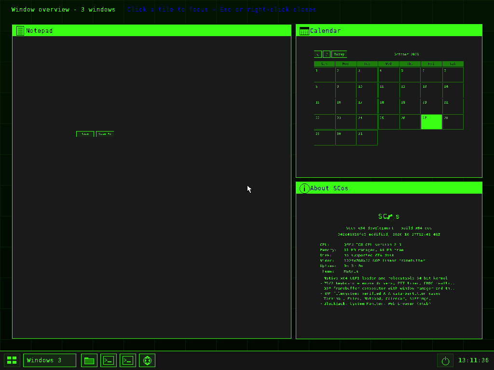

# Bringing `scoswm-arch` back to SCos

[`Joercat/scoswm-arch`](https://github.com/Joercat/scoswm-arch/tree/arena/bb6dd9f1-scoswm-arch)
is a non-compositing **X11 window manager** that reproduces the SCos desktop's
look while managing real Linux applications. It was built for fun on Linux;
this document records what was brought back into native SCos, how, and what
deliberately did not come back.

The starting point matters: SCos already has the desktop look this Linux WM
copied — `kernel/desktop/wm.c` has the 40 px taskbar with its 2×2 launcher
grid, "Windows N" picker, pinned shortcuts, power button and clock; desktop
icons on an 88×96 snap grid over a gradient+grid wallpaper; 26 px titlebars
with min/max/close buttons; and `theme.c`'s four palettes. `PORTING.md` in that
repo maps those back to SCos explicitly. So the useful work was **not** to
re-import the look: it was to port the interaction layer that the Linux WM
added on top of it.

## What was ported

| scoswm-arch feature | Native SCos implementation |
| --- | --- |
| Right-click "Windows N" → MRU visual overview with captured tiles, title strips and green borders | `ov_rebuild()` / `ov_paint()` in `kernel/desktop/wm.c`. **Live previews**: SCos owns every window's back buffer, so `w->surf.px` is scaled nearest-neighbour into the tile — no XComposite redirect, no pixmap capture, no daemon. Tile 0 is the most recently focused window and spans 2×2 cells when there are 4+ windows; the same 1/2/3/4+-window layout rules as `overview_rebuild()`. |
| Click a tile to focus; Esc / right-click closes; arrow keys and Tab move the hover selection | `ov_hit()`, `ov_focus_tile()`, `ov_move()`, `overview_mouse()` and the hotkey block in `handle_key()`. The taskbar stays visible and any taskbar click closes the overview first. Notices are suppressed while tiles own the work area. |
| Global hotkeys: `Alt+Tab` / `Alt+Shift+Tab`, `Alt+F4`, `Alt+F9`, `Alt+F10`, `Super+D`, `Super+Enter`, `Super+M`, `Super+,`, `Super+Q`, `Super+F1..F3` | `wm_cycle_focus()`, `wm_toggle_maximize()`, `toggle_launcher()` and the hotkey block in `handle_key()`. A `super` modifier was added to `struct key_event` / `kbd.c` (set-1 make codes `E0 5B` / `E0 5C`). Alt+Tab captures the MRU list when the cycle starts and resets on Alt release, so Alt+Shift+Tab steps back one window instead of jumping to the oldest. |
| Drag a window to an edge to tile it; hardware media/volume keys | `wm_snap_window(w, side)`: left/right halves, top = maximise, down = restore; also bound to `Super+←/→/↑/↓`. Release-side detection lives in `handle_mouse()`. |
| Live Settings panel: `bar_height`, `desktop_icon_size`, `desktop_grid`, custom palette fields | `kernel/desktop/wm_prefs.c` persists six owner switches in `home/desktop.cfg` (inside the vault): taskbar height 28–96 px, icon size 24/32/48 px, wallpaper grid, global hotkeys, visual overview and edge snapping. Settings gained a **Window manager** section with live −/+ controls. `TASKBAR_H` became `wm_taskbar_height()` (default 40 = the original geometry) and `wm_reflow_windows()` clamps windows after a work-area change. Hand-edited values are clamped, never trusted. |
| Power menu: Lock immediate; Restart WM / Exit WM / Suspend / Reboot / Power Off each with a Cancel-default confirmation | Power menu is now **Lock / Restart / Power Off**. Lock calls `security_ui_lock()` (SCos's own lock, not an external locker). Restart and Power Off go through the new `wm_confirm()`: Cancel is outlined twice on screen **and** is what Enter selects; only an explicit `y` or an OK click acts. `test_wm_port.py` proves pressing Enter does not reboot the machine. |

| Pointer feedback: every pressable surface highlights under the pointer | `kernel/desktop/wm.c`: titlebar buttons (`hover_btn_win` / `hover_btn`, one record for all three), taskbar pins, the Windows picker, the launcher and power button through a single `bar_hover_at()` used by both painting and hit testing, dialog buttons (`d->hover`), menu rows and desktop icons. The highlight is an inverse box on the titlebar and an accent fill elsewhere, because the first attempt used the focused titlebar colour as its fill and was therefore invisible on the focused window. |
| Double-click a titlebar to maximise or restore; drag a maximised window to restore it | `handle_mouse()` titlebar double-click detection and the `drag_win` restore path: a maximised window keeps its restore geometry, so dragging its titlebar back down returns it to the last normal size instead of leaving it stuck at full screen. |
| Wheel over the taskbar cycles windows; titlebar context menu | `handle_mouse()` (`MEV_WHEEL`) cycles the MRU list, and a right-click on a titlebar opens **Minimise / Maximise / Close**. A dialog has no such menu and exactly one titlebar button. |

## Confirmations own the answer, not the desktop

The old confirmation was an ordinary window. Its own Minimise button could hide
it while it still owned the keyboard and the next click, so the desktop looked
idle but accepted nothing until Esc. A confirmation is now a real dialog type:

* it is centred in the work area when it opens, and window management refuses
  to move, resize, snap, minimise or maximise it (`win_is_dialog()`);
* it draws **one** titlebar button - the close cross - and no resize grip;
* an outside click, the cross, Cancel and Escape all answer "no", run the
  owner's callback with `ok == 0`, and destroy the window in the same event, so
  no input owner is left behind. The dismissing click does not reach whatever
  was underneath;
* `test_wm_dialogs.py` drives this with real mouse and key events and asserts
  the serial log never gains a second `wm: entering main loop` (no reboot) and
  the window count returns to where it was.

## What did not come back, and why

* **X11/Xlib, EWMH/ICCCM, RandR, SHAPE, Xcursor, freedesktop `.desktop` and
  PNG/SVG icons.** These are how an X11 WM talks to clients. SCos has no X
  server; its apps are in-kernel surfaces with an `app` registry and
  procedural 24×24 icons. Porting the protocol stack would mean replacing
  SCos with Linux, which is explicitly not the goal.
* **A separate Terminal / Files / SysMon / Settings process set.** SCos keeps
  its own native apps. Settings was extended, not replaced.
* **Wi-Fi panel, `nmcli`, audio OSD, `playerctl`, brightness keys and
  `Super+F1..F3`.** SCos has no network stack, no audio mixer and no
  brightness device. Faking these with a panel that reports nothing would be
  dishonest; they are left out rather than stubbed.
* **Suspend and "restart the WM while preserving clients".** There is no
  systemd and no X11 client reparenting. Lock, restart and power-off are the
  real ACPI/8042 actions SCos can perform.
* **Multiple workspaces.** scoswm-arch itself is single-workspace by design;
  nothing to port.
* **Compositing / thumbnails of obscured X11 windows.** Not needed: every
  SCos window keeps its own back buffer, including when covered.

## Owner choice

Nothing here is forced. Hotkeys, the visual overview and edge snapping are
independent switches in `home/desktop.cfg`, editable live from Settings;
taskbar height, icon size and the wallpaper grid are layout choices, not
security policy. Defaults reproduce the original SCos desktop exactly
(40 px bar, 24 px icons, grid on), and all three behaviour switches default
on because they only add capability. The power menu's destructive entries
always confirm with Cancel as the safe default — that one is not switchable,
matching the Linux WM.

## Verification

`python3 tools/tests/test_wm_port.py` boots QEMU and checks:

* three open windows produce three non-overlapping, in-bounds tiles whose
  first tile is the most recently focused window; `paint_all()` renders the
  live previews (`docs/migration/wm-overview.png` is that framebuffer);
* right-click on "Windows N", arrow-key hover navigation and Esc;
* real `struct key_event` injection for Alt+Tab / Alt+Shift+Tab, Alt+F9,
  Alt+F10, Super+D and Super+arrows, reading back `focused_w`, window state
  and geometry;
* live prefs: a 48 px taskbar is persisted to `home/desktop.cfg`, a 32 px
  icon size repaints without faulting, switching hotkeys off actually stops
  them, and a hand-edited `bar_height = 9999` is clamped;
* `power_menu_cb(1, ...)` opens a confirmation and pressing Enter **does
  not** reboot.

`python3 tools/tests/test_wm_dialogs.py` is the companion suite: it clicks the
power button and the real menu entries, requires exactly one centred dialog
whose only titlebar control is the close cross, and checks that outside clicks,
the Cancel button and Escape all dismiss it without a reboot or a leftover
window. It also asserts titlebar hover for min/max/close and that the gaps
between them clear it, that the buttons hit-test where they are drawn, that a
double-click maximises to the work area, and that `bar_hover_at()` reports the
power button, the picker and the launcher at their drawn positions.

All 21 suites pass, including the existing compositor, management, CAT,
security, isolation, escape and user-mode suites. As always, QEMU success is not
physical-PC acceptance: keyboard firmware may emit different Super scancodes,
and the overview's full repaint path has not been timed on real GPUs.
